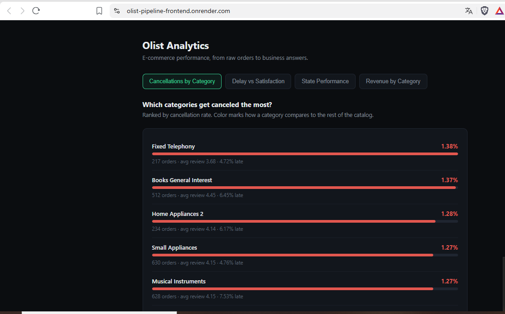

# Olist Analytics Pipeline: BigQuery, dbt and FastAPI

An analytics pipeline for the Olist Brazilian e-commerce dataset. Raw CSV files are loaded into BigQuery, modelled with dbt into a star schema, and served through a FastAPI web service and a static dashboard, deployed as two separate services on Render.

## Live demo and media

| | Link |
|---|---|
| Live dashboard | [https://olist-pipeline-frontend.onrender.com/](https://olist-pipeline-frontend.onrender.com/) |
| Video walkthrough | [Olist Analytics Pipeline: BigQuery + dbt + FastAPI](https://youtu.be/cNeKeRg5ia0) |

The demo runs on a free server that sleeps when idle, so the first request after a pause can take 30-60 seconds.



## Contents

1. [Live demo and media](#live-demo-and-media)
2. [Problem](#problem)
3. [Solution](#solution)
4. [Architecture](#architecture)
5. [Data model](#data-model)
6. [Business questions and endpoints](#business-questions-and-endpoints)
7. [Two data sources](#two-data-sources)
8. [Stack](#stack)
9. [Repository structure](#repository-structure)
10. [Run locally](#run-locally)
11. [BI extracts](#bi-extracts)
12. [Deployment on Render](#deployment-on-render)
13. [Testing](#testing)
14. [Technical decisions](#technical-decisions)
15. [Challenges and learnings](#challenges-and-learnings)
16. [Limitations and next steps](#limitations-and-next-steps)
17. [License](#license)

## Problem

The Olist dataset ships as separate CSV files (orders, items, payments, reviews, customers, products, sellers). They are not ready for analysis: answering "how much do late deliveries hurt satisfaction?" needs joins, consistent definitions and tested transformations, and the answer has to reach people who do not write SQL.

## Solution

1. **Ingest:** `ingest/load_olist.py` loads the CSV files into a raw BigQuery dataset.
2. **Model:** dbt builds staging views, intermediate views and a star schema of tables.
3. **Query:** four business questions are written as SQL files in `analytics/queries/`.
4. **Serve:** a FastAPI web service exposes each question as a JSON endpoint.
5. **Present:** a static dashboard (`frontend/`) fetches those endpoints and draws the results.
6. **Orchestrate:** `run_pipeline.sh` runs ingestion, `dbt run` and `dbt test` in order.

## Architecture

```text
Olist CSV files (Kaggle)
        |  ingest/load_olist.py
        v
BigQuery  raw_olist
        |  dbt
        v
staging (views) --> intermediate (views) --> marts (star schema, tables)
                                                |
                          +---------------------+---------------------+
                          v                                           v
              analytics/queries/*.sql                       analytics/bi/*.sql
                          |                                           |
                          |                     scripts/export_bi_extracts.py --> bi/*.csv
                          v
              FastAPI web service
              DATA_SOURCE = bigquery | snapshot
                          ^
                          |  fetch(API_BASE + '/<endpoint>')   (CORS: GET)
                          |
              Static dashboard (frontend/index.html)
```

### Deployment topology

```text
Browser
  |
  +--> Render Static Site ---> serves frontend/  (HTML, CSS, JS)
  |
  +--> Render Web Service ---> FastAPI (DATA_SOURCE=snapshot) --> snapshots/*.json
```

## Data model

The dbt project has 17 models in three layers. Staging and intermediate are views, marts are tables (configured in `dbt_project/dbt_project.yml`).

| Layer | Materialization | Models |
|---|---|---|
| Staging | view | `stg_category_translation`, `stg_customers`, `stg_order_items`, `stg_order_payments`, `stg_order_reviews`, `stg_orders`, `stg_products`, `stg_sellers` (sources declared in `_sources.yml`) |
| Intermediate | view | `int_order_items_enriched`, `int_orders_enriched`, `int_category_cancellations` |
| Marts | table | `dim_customers`, `dim_date`, `dim_products`, `dim_sellers`, `fct_order_items`, `fct_orders` (documented in `_marts.yml`) |

Star schema grain:

| Table | Grain |
|---|---|
| `fct_orders` | One row per order (99,441 rows): status, delivery days and delay, payment value, review score, cancellation and lateness flags |
| `fct_order_items` | One row per order item (112,650 rows): product, seller, customer, price, freight, category, order-level flags |
| `dim_customers`, `dim_sellers`, `dim_products`, `dim_date` | One row per entity or day |

## Business questions and endpoints

| Endpoint | SQL file | Question |
|---|---|---|
| `GET /category-cancellations` | `01_category_cancellations.sql` | Which product categories have the highest cancellation rates? |
| `GET /delivery-vs-satisfaction` | `02_delivery_vs_satisfaction.sql` | How does delivery delay impact customer satisfaction? |
| `GET /state-performance` | `03_state_performance.sql` | Which Brazilian states have the worst delivery performance? |
| `GET /top-categories-revenue` | `04_top_categories_revenue.sql` | Which product categories drive the most revenue? |

Also available: `GET /api` (service info), `GET /health`, `GET /queries`, interactive docs at `/docs`, and `GET /`, which serves `frontend/index.html` when the file is present (handy for local runs).

Definitions used by the API queries: cancellation rate = canceled orders / all orders, late-delivery rate = late orders / all orders. The BI extracts use late orders / delivered orders, which is stated where they are used.

## Two data sources

The API reads from one of two sources, selected with the `DATA_SOURCE` environment variable:

| Value | Behaviour |
|---|---|
| `bigquery` (default) | Runs the SQL files live against BigQuery |
| `snapshot` | Serves pre-computed JSON from `snapshots/`, no credentials needed |

Snapshots exist because BigQuery sandbox tables expire (60 days by default here). The public web service runs in snapshot mode, so the service account key never leaves the developer's machine. The four snapshot files (one per endpoint) are regenerated with `python scripts/export_snapshots.py`.

## Stack

Python 3.14, BigQuery, dbt Core, FastAPI, Uvicorn, vanilla HTML/CSS/JS frontend, Bash, Render (static site and web service).

## Repository structure

```text
.
├── analytics/
│   ├── queries/                # the four SQL files behind the API
│   └── bi/                     # SQL for the aggregated BI extracts
├── api/
│   ├── main.py                 # endpoints, CORS, data source switch
│   ├── queries.py              # SQL loading and project placeholder
│   ├── bigquery_client.py      # imported only in live mode
│   ├── requirements.txt        # snapshot deployment
│   └── requirements-live.txt   # adds the BigQuery client
├── bi/                         # exported CSV extracts
├── dbt_project/                # staging, intermediate and marts
├── docs/img/                   # README screenshot
├── frontend/index.html         # static dashboard
├── ingest/                     # CSV loader and its requirements
├── scripts/                    # snapshot and BI exports
├── snapshots/                  # pre-computed JSON for the public demo
├── run_pipeline.sh             # ingest, dbt run, dbt test
├── requirements-dbt.txt
├── .env.example
└── LICENSE
```

Not tracked: `.env`, `secrets/` and `data/` (the raw CSV files).

## Run locally

Prerequisites for the full pipeline: a Google Cloud project with BigQuery, a service account key with BigQuery permissions, and the Olist dataset from Kaggle extracted into `data/`.

**Quick start without credentials (snapshot mode):**

```bash
git clone https://github.com/juanquiterio/olist-pipeline.git
cd olist-pipeline
python3 -m venv .venv && source .venv/bin/activate
pip install -r api/requirements.txt
DATA_SOURCE=snapshot uvicorn main:app --app-dir api --port 8000
```

**Full pipeline against BigQuery:**

```bash
pip install -r requirements-dbt.txt -r ingest/requirements.txt -r api/requirements-live.txt
cp .env.example .env     # then fill in your values

./run_pipeline.sh                  # load CSVs, dbt run, dbt test
python scripts/export_snapshots.py
uvicorn main:app --app-dir api --port 8000
```

Open `http://localhost:8000` for the API, or open `frontend/index.html` directly to use the dashboard against the local API. `API_BASE` in `frontend/index.html` must point to the API you want the dashboard to use: `http://localhost:8000` locally, the web service URL in production.

`GOOGLE_APPLICATION_CREDENTIALS` must be an absolute path: dbt runs from `dbt_project/`, so a relative path would not resolve.

Pipeline modes:

```bash
./run_pipeline.sh              # reload CSVs, then dbt run + dbt test
./run_pipeline.sh dbt-only     # dbt run + dbt test only
```

Pinned versions: FastAPI 0.115.6, Uvicorn 0.34.0, google-cloud-bigquery 3.25.0, dbt-core 1.12.5, dbt-bigquery 1.12.1.

## BI extracts

`python scripts/export_bi_extracts.py` runs the SQL in `analytics/bi/` and writes two small aggregated CSV files to `bi/`: orders by month, state and delivery outcome, and items by month, state and category. They are designed for BI tools and are not used by the public demo.

All measures are additive, so any tool can compute correct rates as ratios of sums. The script aborts if the delay convention is not as expected and reconciles its totals against the source tables (99,441 orders and 112,650 items).

## Deployment on Render

The dashboard and the API are deployed separately.

| | Static Site | Web Service |
|---|---|---|
| Serves | The dashboard (`frontend/`) | The JSON API (`api/`) |
| Root directory | `frontend` | Repository root |
| Build command | None (no build step) | `pip install -r api/requirements.txt` |
| Publish directory / start command | `.` | `uvicorn main:app --app-dir api --host 0.0.0.0 --port $PORT` |
| Environment variables | None | `DATA_SOURCE=snapshot` |
| Python | Not applicable | Pinned by `.python-version` |

How they connect:

1. Deploy the web service first and note its URL.
2. In `frontend/index.html`, set `API_BASE` to that URL, without a trailing slash, and push. The static site redeploys.
3. The API enables CORS for `GET` from any origin, which is what lets the static site (a different origin) call it. For production, restrict `allow_origins` in `api/main.py` to the static site's URL.

No credentials are configured on Render. `.env`, `secrets/` and `data/` are git-ignored.

The free web service sleeps after a period of inactivity. The dashboard itself is only static files, but its first data request after a pause can be slow while the service wakes up.

## Testing

`dbt test` runs as the last step of `run_pipeline.sh`, and `run_pipeline.sh` stops at the first failing step. The BI export reconciles its output against the warehouse on every run.

## Technical decisions

| Decision | Why |
|---|---|
| Frontend and backend deployed separately | The dashboard is static files and the API is a web service, so each one deploys and fails independently. The only contract between them is the JSON endpoints and one constant, `API_BASE` |
| Layered dbt project | Staging cleans and renames, intermediate joins and derives, marts expose a star schema. Marts are tables for query speed, earlier layers stay views |
| SQL in files, project id as a placeholder | Queries use `${MARTS}`, replaced at runtime from environment variables. The repository contains no project identifiers |
| Snapshot mode | Decouples the public API from warehouse credentials and from table expiry |
| Lazy BigQuery import | The client library is only imported in live mode, which keeps the snapshot deployment small |
| Fail early in the pipeline script | `set -euo pipefail`, mode validation and explicit checks for the virtual environment and `.env` |
| Additive measures in exports | Rates are computed as ratios of sums, never as averages of averages |

## Challenges and learnings

- **Table expiry.** Reading the dataset configuration showed a 60-day default expiration on every table. That decision shaped the snapshot design.
- **Splitting the services changes how requests work.** Once the dashboard is no longer served by the API, its calls become cross-origin: the API needs CORS, and the dashboard needs an absolute API URL instead of a relative one.
- **Different lifecycles.** The static site is always just files, while the free web service sleeps. Keeping them separate makes that visible instead of hiding it behind one URL.
- **Secrets hygiene.** A pre-commit style check (`git check-ignore`, a dry-run `git add -n`, and a search for secrets) confirmed that the key, `.env` and raw data are never tracked.
- **Leftovers from a previous project.** A search for the old project id found it hard-coded in the SQL files. Replacing it with a placeholder removed the leak and made the queries portable.
- **Reconciling exports.** Comparing exported totals with the source tables caught definition differences before they reached a dashboard (for example, payments include freight while item sales do not).

## Limitations and next steps

- The public demo serves a frozen snapshot, regenerated by hand with `scripts/export_snapshots.py`.
- Live mode needs the warehouse rebuilt with `./run_pipeline.sh` once BigQuery sandbox tables expire.
- There is no scheduler: ingestion, dbt and exports run on demand.
- CORS is open to any origin for `GET`. It should be restricted to the static site's URL in production.

## License

Code: MIT, see `LICENSE`. The Olist dataset has its own license: check it on Kaggle before reusing the data, and keep the attribution.
